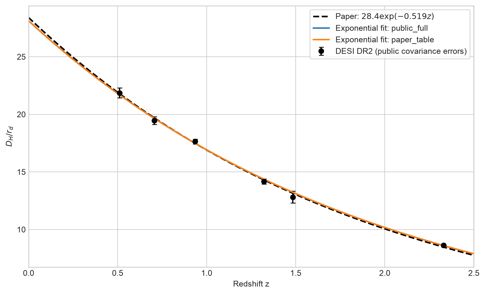
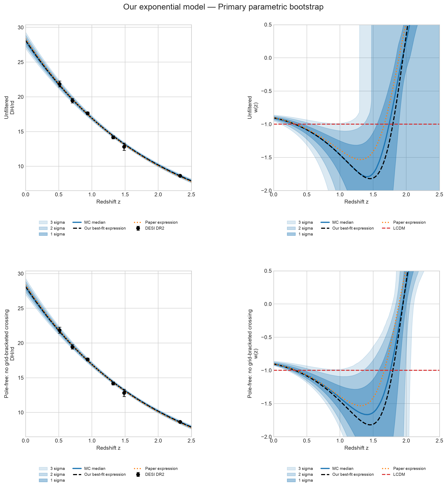

# Figure 1: DESI-only symbolic reconstruction

**Reproduction update**  
**Prepared for discussion with Dr Cindy**  
Keming | 22 September 2026

**Paper:** *Evidence for dynamical dark energy from DESI-DR2 and SN data? A symbolic regression analysis*

## Current status

**Partial reproduction.** The DESI distance-level trend and the preferred exponential model family are recovered, but the published confidence bands and the detailed low-redshift LambdaCDM-consistency statement are not reproduced exactly.

## Experimental design

| Component | Implementation used in the reproduction |
|---|---|
| Data | Six public DESI DR2 radial BAO measurements of `D_H/r_d`, spanning `z = 0.51` to `2.33`. |
| Covariance | Full `6 x 6` public covariance submatrix; paper-table diagonal errors retained as a sensitivity check. |
| Symbolic search | 100 deterministic targeted PySR seeds with `maxsize = 7`. The paper-like exponential family was selected in 66/100 public-covariance runs. |
| Final coefficients | After selecting the modal family `A exp(Bz)`, `A` and `B` were estimated independently by generalized least squares. |
| Uncertainty | 20,000 parametric-bootstrap realizations using the full covariance, with `Omega_m = 0.30` and `r_d = 101 +/- 2.3 h^(-1) Mpc`. |

## Central-expression comparison

The loss used in this reproduction is

```text
L = (1/N) * (y - f)^T * C^(-1) * (y - f)
```

All recomputed losses below use the same public DESI data and covariance.

| Model | Expression | Paper loss | Recomputed loss |
|---|---|---:|---:|
| Table III selected expression | `28.42 / 1.68^z` | 0.30 | 0.664 |
| Main-text Equation (10) | `28.4 * exp(-0.519z)` | - | 0.704 |
| Independent public-covariance fit | `28.120223 * exp(-0.508294z)` | - | 0.407 |



*Distance-level comparison. The independent public-covariance fit and the paper expression are visually very close. Their maximum relative separation over `0 <= z <= 2.5` is approximately 1.7%.*

## PySR stability

The exact symbolic expression selected by PySR depends on the random seed. In the targeted 100-seed experiment using the full public covariance:

- 66 seeds selected a paper-like exponential expression;
- 20 selected a rational or root expression;
- 13 selected another structure;
- 1 selected a quadratic expression.

The exponential was therefore treated as the modal low-complexity model family. Its coefficients were estimated with a separate generalized least-squares fit rather than by selecting the individual seed most similar to the paper.

The resulting independent expression is

```text
D_H(z) / r_d = 28.120223 * exp(-0.508294z)
```

with

```text
chi^2   = 2.444247
chi^2/N = 0.407375
```

For comparison, the rounded main-text expression

```text
D_H(z) / r_d = 28.4 * exp(-0.519z)
```

gives

```text
chi^2   = 4.222491
chi^2/N = 0.703749
```

when evaluated using the same public covariance.

## Reconstruction of w(z)

The small distance-level difference is amplified when `D_H/r_d` is differentiated and inserted into the nonlinear reconstruction of `w(z)`.

For the central curves:

| Feature | Independent fit | Paper expression |
|---|---:|---:|
| Minimum `w(z)` | -1.821 | -1.533 |
| Redshift of minimum | 1.456 | 1.312 |
| Second `w = -1` crossing | 1.798 | 1.669 |
| `w(1.5)` | -1.812 | -1.413 |

## Monte Carlo uncertainty propagation

The primary uncertainty experiment used 20,000 parametric-bootstrap realizations centered on the independently fitted exponential expression. For each realization:

1. Six correlated mock DESI measurements were generated using the full public covariance.
2. Both exponential parameters, `A` and `B`, were refitted.
3. One common `r_d` value was drawn from the adopted Gaussian distribution.
4. The distance curve, its derivative, and `w(z)` were evaluated on a redshift grid.
5. Pointwise 1-sigma, 2-sigma, and 3-sigma intervals were calculated.



*Top: all 20,000 realizations. Bottom: the 16,895 realizations, or 84.5%, with no grid-bracketed pole. The pole-free result is a conditional diagnostic because the paper does not document an equivalent exclusion rule.*

## Key findings

- The central DESI distance reconstruction is reproduced at percent-level precision.
- The published confidence-band boundaries are not reproduced exactly.
- The independent distance expression and the paper expression are visually close, but their derived `w(z)` curves differ more substantially because the reconstruction contains a derivative and a nonlinear denominator.
- In the current pole-free reconstruction, the LambdaCDM line `w = -1` lies inside the pointwise 3-sigma interval only for approximately `0.20 <= z <= 2.06`.
- The apparent exclusion below approximately `z = 0.20` is an extrapolation because the lowest DESI measurement is at `z = 0.51`. It should not be presented as robust low-redshift evidence against LambdaCDM.
- Of the 20,000 primary Monte Carlo realizations, 3,105 contain a denominator pole over `0 <= z <= 2.5`; 16,895 remain after removing these curves.
- The paper does not fully specify how its reconstruction uncertainties were generated or how pole-producing realizations were treated.
- These missing methodological choices prevent an exact reproduction of the published confidence bands.

## Interpretation

The current result supports the following limited conclusion:

> We reproduce the central DESI-only distance reconstruction, but we do not claim an exact reproduction of the published confidence bands or their detailed LambdaCDM interpretation.

The relatively narrow low-redshift interval does not mean that DESI directly constrains the present epoch more strongly. It is conditional on:

- extrapolating the two-parameter exponential model below the lowest DESI redshift;
- fixing `Omega_m = 0.30`;
- the adopted treatment of `r_d`;
- excluding symbolic-model uncertainty;
- the reconstruction denominator remaining far from zero at low redshift.
